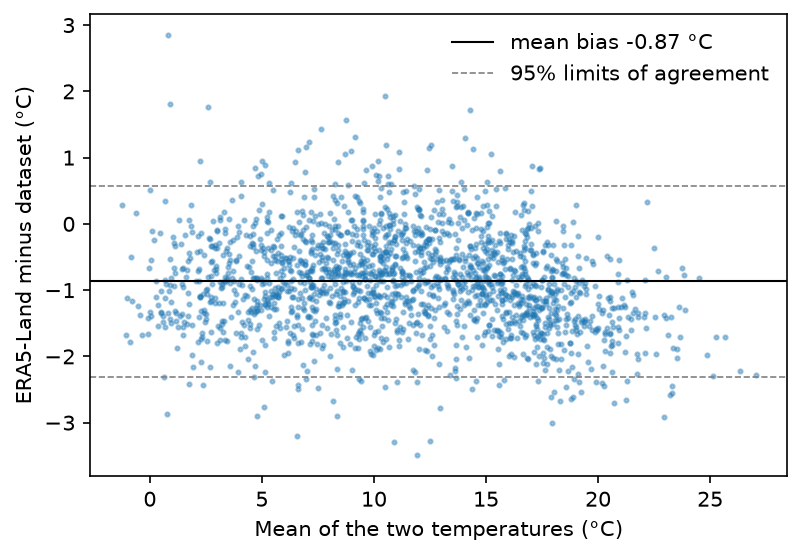
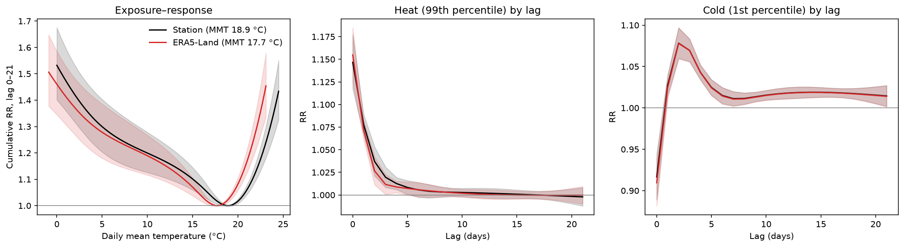

# era5_land_London
ERA5-Land vs. Station temperature for heat- and cold-related mortality in London
# ERA5-Land versus station temperature for heat- and cold-related mortality in London

Reanalysis products such as ERA5-Land are increasingly used in place of weather station data in
environmental epidemiology, as they provide complete, gridded temperature data across space and time.
However, it is not always clear whether the choice of temperature source changes the estimated
temperature–mortality relationship. In this project, I compared daily ERA5-Land temperature with
station-based temperature in London (2002–2006) and estimated the temperature–mortality association
with both, using a distributed lag non-linear model (DLNM) implemented in Python and R.

## Data

- **Daily mortality and station temperature:** daily deaths in London, 2002–2006, from
  Bhaskaran K, Gasparrini A, Hajat S, Smeeth L, Armstrong B. *Time series regression studies in
  environmental epidemiology.* International Journal of Epidemiology 2013;42(4):1187–95.
  The data are available from [github.com/gasparrini/2013_bhaskaran_IJE_Codedata](https://github.com/gasparrini/2013_bhaskaran_IJE_Codedata).
- **ERA5-Land:** hourly 2 m temperature and 2 m dewpoint temperature at 0.1° resolution
  (45 grid cells covering Greater London), December 2001 – December 2006, from the
  [Copernicus Climate Data Store](https://cds.climate.copernicus.eu/).

The data are not included in this repository. The notebooks read the London dataset and download
ERA5-Land directly.

## Methods

**Exposure.** Hourly ERA5-Land temperature was averaged across all London grid cells, converted from
UTC to local time (Europe/London) and aggregated to daily mean, minimum and maximum temperature.
Only complete local days were kept. Relative humidity was derived from temperature and dewpoint
using the Magnus formula.

**Agreement.** ERA5-Land and station temperature were compared using correlation, mean difference
and a Bland–Altman plot.

**Temperature–mortality model.** Daily deaths were modelled with quasi-Poisson time-series
regression, including:
- a cross-basis for temperature: a natural cubic spline with knots at the 10th, 75th and 90th
  percentiles, and a natural cubic spline over lags 0–21 days with knots equally spaced on the
  log scale;
- a natural cubic spline of time with 7 degrees of freedom per year to control for seasonality
  and long-term trends;
- day of the week.

Cumulative relative risks over lags 0–21 were estimated relative to the minimum-mortality
temperature (MMT). The model was fitted separately with station and ERA5-Land temperature.

## Results

**1. ERA5-Land closely tracks station temperature, but is cooler.**
The two series were highly correlated (r = 0.992). However, ERA5-Land was on average 0.87 °C cooler
(95% limits of agreement −2.3 to +0.6 °C), and this difference increased by 0.022 °C per 1 °C rise in
temperature. Therefore, the hottest days were underestimated the most, which is consistent with
grid-cell averaging smoothing out the urban heat island.

**2. Relative risks are almost identical when expressed on each data source's own percentiles.**

| | Station | ERA5-Land |
| --- | --- | --- |
| Minimum-mortality temperature | 18.9 °C | 17.7 °C |
| Heat: 99th percentile vs MMT | 1.36 (1.27–1.46) | 1.33 (1.25–1.42) |
| Cold: 1st percentile vs MMT | 1.50 (1.38–1.63) | 1.47 (1.35–1.60) |

Heat effects were immediate, concentrated on the same day and the following day. Cold effects were
delayed, peaking at lags 2–3 days and persisting for up to three weeks.

**3. Absolute temperature thresholds are not transferable between data sources.**
Although the relative risks were very similar, the whole exposure–response curve was shifted to lower
temperatures with ERA5-Land, and the MMT was 1.2 °C lower. This means that temperature thresholds
derived from station data, such as those used for heat–health warnings, cannot be applied directly
to ERA5-Land data, and vice versa.

Validation: the model was refitted in R with the dlnm package (05_dlnm_R_check.R) using the same specification; minimum-mortality temperatures, relative risks and confidence intervals were identical to two decimal places.

## Notebooks

| Notebook | Content |
| --- | --- |
| `1_era5_land_London.ipynb` | Exploring the London mortality dataset |
| `2_download_era5.ipynb` | Downloading ERA5-Land from the Copernicus Climate Data Store |
| `3_era5_exposure.ipynb` | Building daily London exposures and comparing with station temperature |
| `4_exposure_response.ipynb` | Same-day model and distributed lag non-linear model |

## How to run

1. Install the packages: `pip install -r requirements.txt`
2. Download `londondataset2002_2006.dta` from the link above into a `data/` folder.
3. Create a free Copernicus Climate Data Store account, accept the ERA5-Land licence and save your
   API key in `~/.cdsapirc`.
4. Run the notebooks in order.

## Limitations

This analysis covers a single city over five years and uses all-cause mortality only. The station
temperature series in the London dataset is a single city-wide series, and ERA5-Land was averaged
across Greater London without population weighting.

## Acknowledgements

ERA5-Land data: Muñoz-Sabater J, et al. (2021), Copernicus Climate Change Service. Mortality data:
Bhaskaran et al. (2013). I used an AI assistant for help with Python code; all analyses were run and
checked by me.

## Author

**Dr Ashtyn Tracey Areal**, environmental epidemiologist
